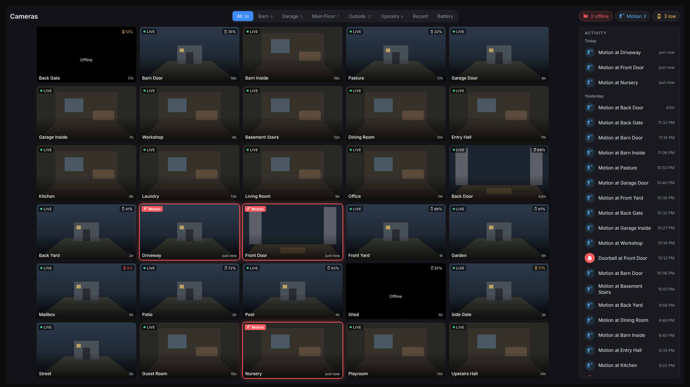

# Camera Wall Card

Every Ring camera on one screen, in the same style as the [Home View Card](https://github.com/iambrayden/haos-home-view).

- Finds all your Ring cameras by itself. No list to keep up to date.
- Fits every camera on screen without scrolling (30 cameras fit on a 1080p wall display). Phones get a scrolling two-column grid.
- Tabs for each Home Assistant area, plus **Recent** (motion or a ding in the last 30 minutes) and **Battery** (lowest first).
- Motion outlines the tile in red with a "Motion" tag. A doorbell press makes it pulse and opens that camera live for 60 seconds.
- Battery level on every battery camera, amber at 20% and red at 10%.
- Offline cameras show greyed out with a dashed border.
- Tap a tile for the live stream. Use the arrows or the ← → keys to step through cameras, and Esc to go back. Long-press opens the normal Home Assistant dialog.
- Activity feed of motion and doorbell events from the last 24 hours. Tap one to open that camera.
- Status chips: cameras offline, doorbells ringing, motion right now, low batteries.



## Install

### HACS

1. HACS → three dots → Custom repositories → add this repo as type **Dashboard**.
2. Install **Camera Wall Card**, then reload the browser.

### Manual

1. Copy `camera-wall-card.js` to `/config/www/camera-wall-card.js`.
2. Settings → Dashboards → three dots → Resources → Add resource:
   - URL: `/local/camera-wall-card.js`
   - Type: JavaScript module
3. Reload the browser.

## Dashboard

1. Settings → Dashboards → **Add dashboard** → New dashboard from scratch. Call it `Cameras`.
2. Open it, three dots → Edit dashboard → three dots → **Raw configuration editor**.
3. Paste [`examples/cameras-dashboard.yaml`](examples/cameras-dashboard.yaml) and save.

The view uses `panel: true` so the wall gets the full width.

To jump here from the Home View, give a camera a tap action:

```yaml
tap_action:
  action: navigate
  navigation_path: /dashboard-cameras/live
```

## Setup

With only this line the card picks up every `camera.*_live_view` from the Ring integration, along with each camera's motion and ding events and its battery sensor:

```yaml
type: custom:camera-wall-card
```

Tabs come from the area each Ring device is assigned to (Settings → Devices → the camera → pencil icon → Area). Cameras without an area only show under **All**.

To leave some out:

```yaml
type: custom:camera-wall-card
exclude:
  - camera.test_cam_live_view
```

To pick the cameras and their order yourself:

```yaml
type: custom:camera-wall-card
cameras:
  - camera.front_door_live_view
  - entity: camera.driveway_live_view
    name: Drive
    group: Outside
  - entity: camera.nursery_live_view
    motion: binary_sensor.nursery_motion
```

When `cameras:` is set, only those show. Add `discover: true` to put the rest after them.

## Options

| Option | Default | Description |
| --- | --- | --- |
| `title` | `Cameras` | Card heading |
| `cameras` | | List of camera entities or `{entity, name, group, motion, ding, battery, snapshot}` |
| `exclude` | | Cameras to skip |
| `platform` | `ring` | Integration to discover from. Set `false` to turn discovery off. |
| `discover` | `false` | With `cameras:` set, also add every discovered camera after them |
| `include_last_recording` | `false` | Also show the `_last_recording` cameras |
| `groups` | `true` | Tabs from areas. `false` to turn off. |
| `refresh` | `20` | Seconds to cycle through all snapshots. Requests are spread out, so 30 cameras at 20s is one request about every 0.7s. |
| `fit` | `auto` | Fit every tile on screen. `auto` does this on screens 700px and wider. `true` always, `false` never. |
| `columns` | | Fixed number of columns instead of fitting |
| `height` | | Height in px to fit into. Defaults to what's left of the browser window. |
| `min_tile_width` | `150` | Below this the grid scrolls instead of shrinking further |
| `aspect` | `16/9` | Tile shape |
| `motion_seconds` | `90` | How long a tile stays red after a motion or ding event |
| `recent_minutes` | `30` | Window for the **Recent** tab |
| `ding_popup` | `true` | Open a camera live when its doorbell rings |
| `popup_seconds` | `60` | Close that pop-up after this long. Touching it keeps it open. `0` keeps it open. |
| `battery_low` | `20` | Battery % that counts as low |
| `show_battery_below` | `100` | Only show the battery tag at or below this % |
| `log` | `true` | Activity feed. Sits to the right on wide screens and below on narrow ones. |
| `log_title` | `Activity` | Heading for the feed |
| `log_hours` | `24` | How far back to load history |
| `log_max` | `80` | Most entries to keep |

## Ring and live video

Ring only streams on demand, and battery cameras drain fast while streaming, so the wall shows snapshots that refresh in rotation. Only the camera you open streams live. How fresh a snapshot is depends on Ring: wired cameras update often, battery cameras less often, and some only after motion.

The snapshots pause while a camera is open full size or the tab is in the background.

## Theming

Same variables as the Home View Card:

```
--hv-bg  --hv-text  --hv-muted  --hv-accent  --hv-closed  --hv-open  --hv-warm  --hv-cool
--hv-log-width  --cw-gap  --cw-min-width  --cw-aspect
```

## Demo

`demo/index.html` runs the card with 30 fake Ring cameras. Motion fires every few seconds. Add `?ding` to the URL to see a doorbell press.

```bash
python3 -m http.server 8000
```

Then open http://localhost:8000/demo/.
